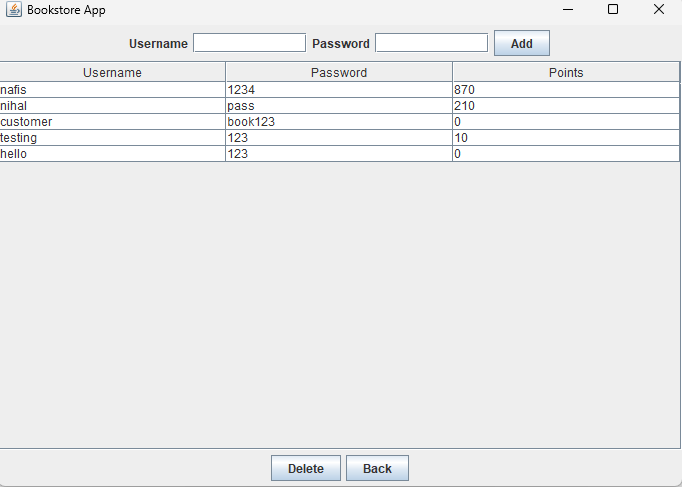
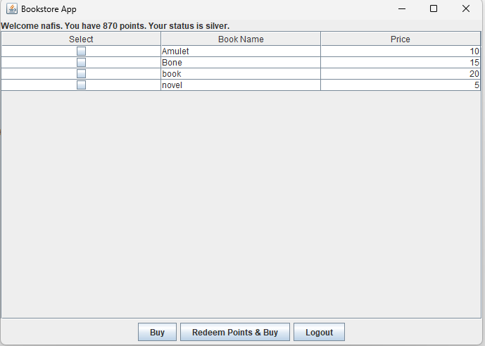

# Bookstore App

A Java desktop bookstore application with a graphical interface. An owner manages the book catalogue and customer accounts, and customers earn and spend points when they buy books.

## Features

**Owner (admin)**
- Add and delete books (name and price)
- Add customer accounts (username and password)

**Customer**
- Log in with a username and password
- Browse the book list and buy books with money or points
- View their points total and membership status
- Receipt shown after each purchase

**Loyalty system**
- Customers start as **Silver** (under 1000 points) and become **Gold** at 1000 points or more
- Paying with money earns **10 points per dollar**
- Paying with points deducts **$1 for every 100 points**, and points can cover the full price if the customer has enough

## Tech
- Java [Swing / JavaFX], NetBeans (Ant) project
- Object-oriented design: [e.g., State pattern for Silver/Gold tiers]
- Data stored in plain text files (`books.txt`, `customers.txt`)

## Run it
1. Clone the repo: `git clone https://github.com/Nafis-N/Bookstore-App.git`
2. Open the folder in NetBeans (**File → Open Project**) and click **Run**.
3. Log in as the owner with username `admin` and password `admin`, or use a customer account from `customers.txt`.

## Screenshots

## Notes
Built as a course project. Accounts and passwords are stored in plain text and the admin credentials are fixed, which is fine for a demo but not for production.
